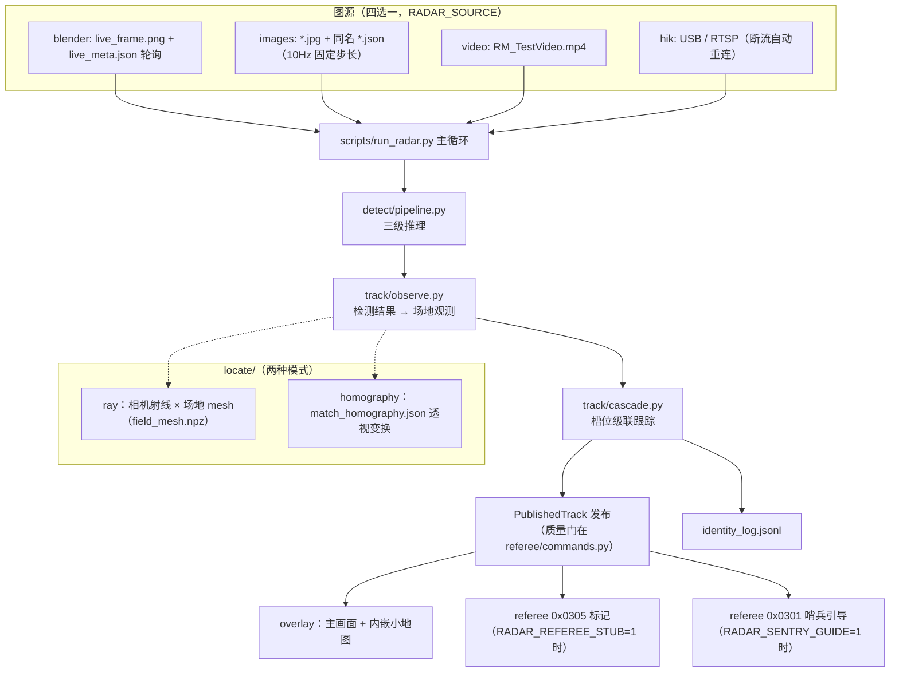

# 系统架构深讲

> 版本：v1.0 | 最后更新：2026-10
> 面向：需要**改代码**的接手者。只想跑起来看[操作手册](radar_operation.md)即可。
>
> 本文回答"每个模块为什么长这样"。所有常量、类名、文件路径均以仓库代码为准。

---

## 目录

1. [数据流总图](#1-数据流总图)
2. [目录导览](#2-目录导览)
3. [检测模块 detect/](#3-检测模块-detect)
4. [定位模块 locate/](#4-定位模块-locate)
5. [跟踪模块 track/](#5-跟踪模块-track)
6. [裁判模块 referee/](#6-裁判模块-referee)
7. [仿真体系 scene/](#7-仿真体系-scene)
8. [日志与数据格式](#8-日志与数据格式)
9. [与其他方案的对比](#9-与其他方案的对比)

---

## 1. 数据流总图



一帧的生命周期：`run_radar.py::main` 取帧 → `detector.infer(frame, persist_tracks=False)` →
`observations_from_result(result, pose, homography, mesh)`（底边像素 → 场地米制）→
`tracker.step(observations, dt)` → 发布 → 显示/发裁判/写日志。

---

## 2. 目录导览

```
detect/            三级检测（BoT-SORT 配置在 detect/trackers/botsort.yaml）
  pipeline.py      推理编排：车 → ROI 裁剪 → 装甲 → 图案（PatternStage 注入式）
  trt_model.py    TensorRT engine 加载（无 TRT 时落回 .pt）
  weights.py       权重查找：engine 优先于 pt
  runtime.py       运行时加载器：三级权重回退 + engine 自动编译 + TrtPatternNet（原 scripts/visualize_two_stage.py 的内核）
  geometry.py      裁剪/夹框/重映射
  parse.py         ultralytics 输出 → 内部 Detection
  pattern.py       PatternStage 协议（图案分类是 torch 模型，不是 YOLO）
locate/           像素 → 场地米制
  camera.py        CameraPose（K/R/t/dist/C），project() 投影
  ray_mesh.py      FieldMesh.from_npz：射线 × 场地三角面片
  ray_plane.py     pixel_to_ground：射线 × z=0 平面（mesh 缺失时的回落）
  pnp.py           solve_pose：地标点击 → 完整外参（cv2.solvePnP）
  homography.py    HomographyMap：画面 ↔ 场地透视变换
  landmarks.py     地标表加载（pydantic 校验，z 字段 PnP 专用）
  minimap.py       minimap_from_path：场地米制 → 俯视图像素
  field.py         场地常量：28×15，x∈[-14,14]，y∈[-7.5,7.5]
referee/          裁判串口协议
  frame.py         帧格式（SOF/CRC8/CRC16）打包解包
  commands.py      0x0305/0x0301/0x0121 编解码 + marks_from_publishes 质量门
  stub.py          离线裁判：P 公式（金标 test_rulebook_example）
  link.py          RefereeLink：雷达侧收发
  transport.py     传输层抽象（LoopbackPair 用于 stub；真机换串口实现）
  policy.py        should_trigger_double：双倍易伤触发策略
  crc.py           CRC8/CRC16 实现
track/            槽位跟踪
  cascade.py       CascadeMatchTracker：级联匹配 + 身份投票 + 状态机
  assign.py        min_cost_pairs：带拒绝门的最小代价匹配
  kalman.py        PlanarKalman：平面匀速模型，转弯自适应 Q
  observe.py       检测结果 → FieldObservation（含底边射线定位）
  guess.py         apply_guess_to_lost：LOST 战略猜点
  truth.py         仿真真值解析（robots json → SimRobot）
  log.py           identity_log.jsonl 读写
  names.py         槽名 ↔ 阵营/角色
  score.py         打分帧结构
models/           训练
  train.py         typer CLI：car / armor 两级（Ultralytics YOLO26）
  pattern/         图案分类器子包（MobileNetV3-Small / EfficientNet-B0）
  configs/         数据集 yaml（data_car.yaml / data_armor.yaml / *_hard 变体）
scripts/          入口脚本（见操作手册 §10）
tools/            pt → onnx → engine 导出
dataset/          收割与数据集准备脚本（图像不进 git）
scene/            Blender 仿真（blend / 渲染循环 / 相机导出 / mesh 导出）
tests/            pytest（按模块镜像源码结构）
docker/           Linux GPU 容器
refs/             官方协议/规则手册本地留档（不进 git）
runs/             训练输出（不进 git）
weights/          推理权重（不进 git；历代副本在 weights/archive/）
zaowu_audit/      场地建模审计工作区：渲染对比 / fix 补丁链 / STL·STEP 中间物（**在用**，不进 git）
```

---

## 3. 检测模块 detect/

### 3.1 为什么是三级粗到细

港科大 RM2025 方案验证过的结构：全图直接找装甲（192px 目标在 1280 全图上只有 ~15px）不可行；
先车后装甲把装甲目标放大到可检测尺寸，图案再在装甲 ROI 上放大到可分类尺寸。

| 级 | 模型 | imgsz | conf | max_det | 跟踪 |
|---|---|---|---|---|---|
| 车 | YOLO26s | 1280 | 0.45 | 10 | BoT-SORT（帧内） |
| 装甲 | YOLO26n | 192 | 0.3 | 1 | 无（predict only） |
| 图案 | MobileNetV3-Small | 64 | — | — | 无（时序投票在跟踪层） |

### 3.2 设计要点（`detect/pipeline.py` 文件头 + 实现）

- **车 conf 0.45**：仿真里塔的误检大约出现在 0.3，0.45 留出裕量。
- **装甲 max_det 1**：一个车 ROI 内只取最显著一块装甲；多装甲由多车框覆盖。
- **装甲级不 persist**：裁剪 ROI 无帧间连续性，persist 会串 ID。
- **主循环 persist_tracks=False**：跨帧身份属于槽位跟踪器（`track/`），检测内 BoT-SORT 只提供帧内 bot_id 稳定性（`BOT_BONUS` 匹配加分用）。
- **PatternStage 是注入的**：`pattern.py` 定义协议，pipeline 不 import 具体模型——没注入时行为退化为两级，方便单测。
- **engine 优先**（`weights.py`）：`.engine` 与 `.pt` 同卡混用会因 cuDNN/TensorRT 两套推理栈互相拖慢，统一走一种。

### 3.3 装甲 dead 与"判死"

装甲 YOLO 有 red / blue / dead 三类。`FieldObservation.armor_dead` 表示本帧该车装甲全被检成 dead。
**单帧 dead 不可信**（仿真实测 28% 误闪）——跟踪层 `DEAD_FRAMES = 5`（0.5 s @10Hz）连续全 dead 才判死。

---

## 4. 定位模块 locate/

### 4.1 三条定位路径

| 路径 | 入口 | 数学 | 适用 |
|---|---|---|---|
| 射线 × mesh | `ray_mesh.py::FieldMesh` | 底边像素 → 相机射线（`camera.py::project` 的逆）→ 与场地三角面片求交 | 仿真 / 真机 PnP 后（**主路径**） |
| 射线 × 平面 | `ray_plane.py::pixel_to_ground` | 同上，但只打 z=0 | mesh 缺失时回落 |
| 单应 | `homography.py::HomographyMap` | 画面点 → 场地点的 3×3 透视变换 | 备选（无平面外结构假设失败时） |

`field_mesh.npz` 由 `scene/armor_assets/export_field_mesh.py` 从 blend 导出**非机器人场地三角面**，
射线打中机器人自己的框底边时不受机器人 mesh 干扰。

### 4.2 CameraPose（`camera.py`）

JSON 字段：`name / image_size[w,h] / K 3×3 / R 3×3 / t 3×1 / dist 5 / C 相机中心`。
- 仿真：`dump_radar_cameras.py` 从 Blender 相机导出（dist 全 0）。
- 真机：`calibrate_pnp.py` 用内参 + 6 地标点击解出 R/t（`pnp.py::solve_pose`，cv2 PnP），写出同构 JSON（`Camera_Field.json`）。
- `calibrate_pnp.py` 残差 > `MAX_RESIDUAL_PX = 12.0` 视为点击错误。

### 4.3 精度预算（`scripts/validate_pnp.py` 仿真真值基准）

| 点击噪声 | 端到端中位 / P90 |
|---|---|
| 0 px（完美） | ~0 m / ~0 m |
| 10 px（很糙） | ~0.1 m / **0.24 m** |

裁判准确线 0.8 m——即使手点很糟也有 3 倍余量，这是"PnP 优先于单应"的定量依据。

---

## 5. 跟踪模块 track/

### 5.1 为什么是"固定兵种槽"而不是"自由目标 ID"

裁判 0x0305 的 12 个槽是**固定语义**（敌方英雄/工程/步3/步4/空中/哨兵 + 己方同序）。
发错槽 = 白送对手信息 + 自己 P 归零。所以跟踪的基本单位从一开始就是槽（`SlotId = 阵营 × 角色`），
检测的 bot_id 只是软线索——这消除了"检测 ID 与裁判槽对齐"这一整个易错层。

### 5.2 状态机（`track/types.py::TrackPhase`）

```
INACTIVE ──观察进门──► TENTATIVE ──CONFIRM_HITS=2 连中──► CONFIRMED
                        │                                │
                        └─ 消失 ──► (回 INACTIVE)         └─ 漏检 ──► LOST
                                                        LOST ──COAST_FRAMES=5 无观测──► (停发/回 INACTIVE)
```

### 5.3 级联匹配（`cascade.py::CascadeMatchTracker`）

观测 → 槽的代价 = 距离为主 + 软代价修正，`assign.py::min_cost_pairs` 拒绝超过 `MATCH_GATE_M = 2.5` 的配对：

| 软代价项 | 值 | 意义 |
|---|---|---|
| `BOT_BONUS` | 0.8 | 检测内 BoT-SORT id 一致 → 大幅降代价 |
| `PATTERN_BONUS` | 0.2 | 图案与槽角色一致 → 降代价 |
| `PATTERN_PENALTY` | 0.35 | 图案冲突 → 升代价 |
| `TEAM_PENALTY` | 0.5 | 灯色与阵营冲突 → 升代价 |
| `BIRTH_CONF` | 0.5 | 新生槽需要的最低图案置信度 |

### 5.4 身份历史投票（防小陀螺闪变）

每槽维护最近 `_HIST_LEN = 30` 帧的（阵营，兵种）票，取最近 `_HIST_WINDOW = 10` 帧指数加权
（τ = `_HIST_TAU = 0.5`）出分布——**单帧 dead / 错标翻不动已确认槽**。发布门（质量门）见 §6.3。

### 5.5 卡尔曼（`kalman.py`）

平面匀速模型。转弯自适应过程噪声 Q：直行时 Q 小（平滑），角速度大时 Q 大（跟得上）。
LOST 期间纯外推，发布门决定外推点是否真的发出去（操作手册 §11.4）。

### 5.6 关键常量速查（`cascade.py` 顶部）

```python
MATCH_GATE_M = 2.5      # 配对距离拒绝门（米）
CONFIRM_HITS = 2         # TENTATIVE → CONFIRMED 连中数
COAST_FRAMES = 5         # LOST 维持帧数（0.5s @10Hz）
DEAD_FRAMES  = 5         # 连续全 dead 判死
BIRTH_CONF   = 0.5       # 新生槽最低图案置信度
```

---

## 6. 裁判模块 referee/

### 6.1 分层

```
frame.py      帧格式：| SOF 0xA5 | len u16 | seq u8 | CRC8 | cmd u16 | data | CRC16 |
crc.py        CRC8(0x8C 反射, 初值 0xff, 只校帧头4B) / CRC16(0x8408, 覆盖整帧)
commands.py   命令字编解码 + 质量门
link.py       雷达侧收发（RefereeLink）
transport.py  传输抽象：LoopbackPair（stub 回环）↔ 真串口（未接线）
stub.py       离线裁判（P 公式 + 比赛阶段 + 双倍易伤）
policy.py     双倍易伤触发策略（should_trigger_double）
```

### 6.2 雷达相关命令字（详见 [协议笔记](referee_protocol_notes.md)）

| 方向 | cmd | 语义 |
|---|---|---|
| ↑ | 0x0305 | 小地图标记，48B = 12 槽 × u16 cm，≤5Hz，(0,0)=不发送。槽序：重装/保留/步3/步4/保留/哨兵，己方同序。标签 2 不发 |
| ↑ | 0x0301 → 0x0121 | 雷达自主决策 13B：双倍计数 + 密钥 + 加固占位（默认后 5 字节为 0），接收者 0x8080 |
| ↓ | 0x0001 | 比赛状态（阶段 + 剩余时间） |
| ↓ | 0x0003 | 血量 24B。不驱动双倍或标记门 |
| ↓ | 0x020C | 标记进度掩码 2B。bit0 敌方重装易伤；bit1、bit4 保留 |
| ↓ | 0x020E | 雷达信息 8B：byte0 双倍机会/触发中/加密等级；其后为加固状态与圆心 mm |

### 6.3 发布质量门（`commands.py::marks_from_publishes`）

```python
TENTATIVE → 一律不发          # 两帧确认前的身份不可信
CONFIRMED → 发                 # 真看见了
LOST      → include_lost 决定   # RADAR_SEND_LOST=1 才发（外推误差中位数 <0.8m 时收益 +67%）
Q（前哨） → 不进 0x0305
```

设计依据（规则手册 5.6.6）：错发比静默代价高得多——错误判定连扣 P 且中断 x 归零；
不发 (0,0) 不扣进度。**"没把握就不发"是全链最重要的一条策略。**

### 6.4 stub 裁判（`stub.py`）

常量：`ACCURATE_M=0.8 / SEMI_ACCURATE_M=1.6 / INTERRUPTION_S=0.5 / P_MAX=150 / DOUBLE_CHANCE_S=60 / DOUBLE_ACTIVE_S=30`。
金标测试 `test_rulebook_example` 逐值对照规则手册 worked example（5Hz 全准 3s 到 P=120 → 5 连扣 → 中断 → 复准）。
比赛阶段由 `RADAR_PHASE_SCALE` 压缩以便短回放覆盖阶段切换。

---

## 7. 仿真体系 scene/

| 文件 | 职责 |
|---|---|
| `RMUC2027_V1.0.0_radar_fixed.blend` | 2027 场地主文件（CAD/贴图不进 git） |
| `armor_assets/radar_sim_loop.py` | 实时源：循环渲染 → `live_frame.png` + `live_meta.json`（`--motion off|patrol`、`--camera Blue|Red|alternate`） |
| `armor_assets/generate_radar_car_sim.py` | 离线渲染帧序列（带 YOLO 标签真值）：`--motion patrol --count 200 --dt 0.1 [--spin]` |
| `armor_assets/dump_radar_cameras.py` | 导出蓝/红雷达相机 K/R/t JSON（`--render` 顺带渲一帧 GT） |
| `armor_assets/export_field_mesh.py` | 导出场地三角面 `field_mesh.npz` |
| `armor_assets/bake_radar_fov_docs.py` | 烘焙 6/8/12mm 镜头覆盖图（`docs/radar_visibility_*.png`） |
| `armor_tools/archive/` | 已应用的一次性修复链 + 一次性场景工具（README 有登记，**勿在当前 blend 重跑**；2026-10 又移入 fix_visibility_overlay / restore_robots / _build_official / _build_textures 四件） |

灯条修复链（如在新 blend 重建）：`fix_lamp_strength.py`（自发光 40→6）→ `fix_view_transform.py`（AgX→Standard）→ `fix_lamp_color.py`。

---

## 8. 日志与数据格式

### 8.1 identity_log.jsonl（`track/log.py::append_frame`）

```json
{"frame": 42,
 "gt":   [{"name": "Hero", "team": "red", "x": -3.2, "y": 1.1, "z": 0.3}],
 "pred": [{"slot": "R1", "x": -3.1, "y": 1.3, "state": "confirmed"}]}
```

`state ∈ inactive / tentative / confirmed / lost`。打分脚本先投影 GT 过滤"画面可见"再配对。

### 8.2 referee_log.jsonl（仅 stub 模式）

逐帧每槽 `{sent, judge, d, p, vuln}` 等（`stub.py::log_frame`）；`score_referee.py` 汇总成
union vuln / 准确率 / P 终值报告。

### 8.3 images 序列真值 json

`{frame, camera, dt, robots: [{name, team, x, y, z}]}`——`dt` 固定回放步长（默认 0.1s），
`camera` 决定该帧用哪个位姿（Blue/Red，选不到回落 Blue）。

---

## 9. 与其他方案的对比

| | 港科大 RM2025 | 本仓 |
|---|---|---|
| 车检测 | YOLOv12-s @ 1280 | YOLO26s @ 1280 |
| 装甲检测 | YOLOv12-n @ 192 | YOLO26n @ 192 |
| 图案 | MobileNet-V2，带颜色 | MobileNetV3-Small @ 64，6 类 `(1,2,3,4,S,Q)` |
| 定位 | 像素射线打场地 mesh | 仿真射线 + 真机 PnP 6 点（推荐）/ 单应（备选） |
| 跟踪 | 匈牙利 + 卡尔曼 | 级联匹配 + 身份投票 + 发布门 + 自适应 Q |
| 裁判系统 | 有（C++） | Python 骨架 + stub 裁判 + 离线基准（真串口待接） |
| 哨兵引导 | — | 0x0301 机器人间通信 |

### 基准演进（union vuln @ 2026 dwell 序列）

| 配置 | union vuln | 准确率 |
|---|---|---|
| 修复前 | 7.1 s | 26% |
| v2 模型修复后 | 15.2 s | 47% |
| v3 + 发布门 + 停顿行为 | **17.2 s** | **50.9%** |
| 2027 场地 + 旧模型直跑 | 9.6 s | 44.3% |

> 2027 场地直跑 9.6 s 且 d_med 0.02-0.54 m——新场地更利于检测，但模型仍是旧域；
> 全链重训后预期显著提升（见[迁移计划](migration_2027.md) §2.3）。
