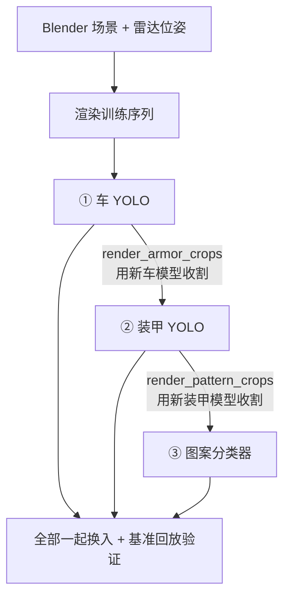

# 训练与导出指南

> 版本：v1.0 | 最后更新：2026-10
> 覆盖：三级模型的训练、数据收割、**级联依赖**、导出与换入验收。
> 换场地/换年份的全链重训流程另见[迁移计划 §2.3 / §五](migration_2027.md)。

---

## 目录

1. [总原则：级联依赖](#1-总原则级联依赖)
2. [车 YOLO 训练](#2-车-yolo-训练)
3. [装甲 YOLO 训练](#3-装甲-yolo-训练)
4. [图案分类器训练](#4-图案分类器训练)
5. [数据收割链](#5-数据收割链)
6. [导出：pt → onnx → engine](#6-导出pt--onnx--engine)
7. [换入验收门](#7-换入验收门)
8. [训练故障速查](#8-训练故障速查)

---

## 1. 总原则：级联依赖



> ⚠️ **血泪教训（级联崩塌）**：❌ 单独训/换任一模型 → 下游因 ROI 域偏移而崩塌。
> 上一级的输出域变了，下一级的训练数据就过时。**要么全链一起换，要么一个都别动。**

时间预算（5070 台式机，来自 [迁移计划 §2.3](migration_2027.md)）：
渲染 3 序列 ×200 帧 ~30 min → 训车 3-5 h → 收割+训装甲 ~1 h → 收割+训图案 ~1 h → 基准验证 ~30 min。
**总计 ~6-8 小时 = 一个完整训练日。**

---

## 2. 车 YOLO 训练

### 2.1 命令（仓库根目录）

```bash
python -m models.train car --data models/configs/data_car.yaml
# 常用覆盖项：
python -m models.train car --data models/configs/data_car.yaml \
    --imgsz 1280 --batch 8 --epochs 20 --name car-yolo26s-xxx
```

| 参数 | 默认 | 说明 |
|---|---|---|
| `--data` | 必填 | YOLO data.yaml 或含 images/labels 的数据集根目录 |
| `--model` | `yolo26s`（car） | 覆盖预训练权重；**精调新场地时从旧 checkpoint 起** |
| `--epochs` | 500 | 精调 20 通常够 |
| `--imgsz` | 1280（car） | |
| `--batch` | Auto | 8GB 5070 用 8；更大卡可加 |
| `--device` | `0` | cuda 编号 / `cpu` |
| `--project` | `runs/detect` | Ultralytics 工程目录 |
| `--resume` | 关 | 从上次 checkpoint 续训 |

- 数据集配置见 `models/configs/`（`data_car.yaml` 及 `_hard` / `_8mm` / `_patrol_*` 变体——难例与镜头焦距特化）。
- 本机一键版（含 CUDNN PATH 修复）：`python scripts/run_car_train.py`；观察训练：`python scripts/watch_car_train.py [--run <dir>] [--loop 30]`。

### 2.2 数据从哪来

`dataset/render_car_crops.py` 用**旧车模型**在渲染序列上自动打标收割（图像不进 git）；
`dataset/merge_car_datasets.py` 合并多源；`dataset/supplement_hard_samples.py` 补难例。

### 2.3 训练完 ≠ 能换

**必须过 `eval_foot_ray.py` 验收门**（§7），过线才允许替换 `weights/car_best.engine`。

---

## 3. 装甲 YOLO 训练

```bash
python -m models.train armor --data models/configs/data_armor.yaml \
    --imgsz 192 --batch 64 --epochs 60
```

- 默认骨干 `yolo26n`，输入 192（ROI 级），max_det 1 是推理期配置（`detect/pipeline.py`）。
- 分类：红 / 蓝 / dead（灯条熄灭态）。
- **前置依赖**：训练数据要用**新车模型**收割（`dataset/render_armor_crops.py --seq <序列> --tag <年>`）。
- 备选变体：`data_armor_hard.yaml`（难例）。

---

## 4. 图案分类器训练

```bash
python -m models.pattern.train --data dataset/pattern_balanced
# 主要参数（typer CLI，--help 看全）：
#   --epochs 100（默认，对齐港科大）  --batch 32  --imgsz 64
#   --lr 3e-4  --backbone mobilenet_v3_small | efficientnet_b0
#   --init-weights <best.pth>   # 难例再训练热启动
#   --project runs/pattern --name mobilenetv3-small
```

- 6 类 `(1, 2, 3, 4, S, Q)`；`Q`（前哨）不进运动池但分类器要认。
- 类别布局：类文件夹（每类一个子目录）或港科大公开集布局均可，`--val-ratio 0.2` 分层验证。
- 默认 ImageNet 预训练 + inverse-frequency 类权重。
- 分支说明：`main` = MobileNetV3-Small @ 64；`pattern-efficientnet-b0` 分支 = EfficientNet-B0 @ 96 对照实验。
- **前置依赖**：训练数据用**新装甲模型**收割（`dataset/render_pattern_crops.py`）或仿真合成
  （`dataset/sim_pattern_crops.py`）。

---

## 5. 数据收割链

`dataset/` 下的脚本按级联顺序使用（图像不进 git）：

| 脚本 | 输入 | 输出 | 用谁的模型 |
|---|---|---|---|
| `render_car_crops.py` | 渲染序列 | 车级训练数据 | 旧车模型（自动打标） |
| `render_armor_crops.py` | 渲染序列 + 车框 | 装甲 crop 训练数据 | **新车模型** |
| `render_pattern_crops.py` | 渲染序列 + 装甲框 | 图案 crop 训练数据 | **新装甲模型** |
| `sim_pattern_crops.py` | 仿真合成 | 图案增强样本 | — |
| `prepare_car_dataset.py` / `prepare_armor_dataset.py` / `prepare_armor_pattern_dataset.py` | 原始收割 | YOLO/分类数据集布局 | — |
| `merge_car_datasets.py` | 多源车数据 | 合并集 | — |
| `supplement_hard_samples.py` | 难例清单 | 补充样本 | — |
| `restore_divergent_labels.py` | 异常标签 | 修复后标签 | — |
| `convert_rm27_armor.py` | 2027 素材 | 装甲数据 | — |

渲染序列由 `scene/armor_assets/generate_radar_car_sim.py` 生成（含真值 json，
见[操作手册 §5.1](radar_operation.md)）。

---

## 6. 导出：pt → onnx → engine

导出脚本会**自动从 PATH 剥离外部 CUDNN**（v9.22 与 PyTorch 自带 9.2 冲突），勿自己绕过。

### 6.1 车 / 装甲 —— `tools/pt_to_engine.py`（pt → onnx → engine 一条龙）

```powershell
# 车（默认就是 car_best）
python tools/pt_to_engine.py

# 装甲：环境变量覆盖
$env:YOLO_PT="runs/detect/<run>/weights/best.pt"
$env:YOLO_ENGINE="weights/armor_best.engine"
$env:YOLO_IMGSZ="192"; $env:YOLO_BATCH="8"
python tools/pt_to_engine.py
```

| 环境变量 | 默认 | 说明 |
|---|---|---|
| `YOLO_PT` | `weights/car_best.pt` | 源权重 |
| `YOLO_ENGINE` | `weights/car_best.engine` | 产物 |
| `YOLO_IMGSZ` | `1280` | 装甲改 `192` |
| `YOLO_BATCH` | `1` | 装甲改 `8`（推理批） |
| `YOLO_DEVICE` | `0` | 构建用卡 |

流程：Ultralytics 导出 FP16 ONNX（opset 18）→ TRT strongly-typed 构建 → engine 前附加
元数据长度头（names/imgsz/stride，供 `detect/trt_model.py` 解析）。

### 6.2 图案 —— `tools/pattern_to_engine.py`

```powershell
$env:PATTERN_PT="runs/pattern/<name>/models/best_mobilenetv3_small.pth"
$env:PATTERN_ENGINE="weights/pattern_best.engine"
python tools/pattern_to_engine.py
```

`PATTERN_ONNX` 可指定中间产物路径。固定 @64 / batch 8 / opset 18。

### 6.3 只出 ONNX —— `tools/pt_to_onnx.py`

改文件头 `PT_PATH` / `IMGSZ`（装甲 192，车 1280）后直跑。Docker 内 engine 重编也走
`.pt` / `.onnx`（engine 与 GPU 绑定，见[操作手册 §13 #14](radar_operation.md)）。

---

## 7. 换入验收门

新权重进入 `weights/` 前的强制检查（对应[接手清单 §6](handover_checklist.md) 验收表）：

```bash
# 1. 车模型门禁：held-out 仿真帧底边射线验收
python scripts/eval_foot_ray.py --weights <新best.pt> --old-weights weights/car_best.pt
#    判据：有误差样本 且 无漏检 且 无场外点 且 无超量检测 → 过线才允许替换

# 2. 全部换入后：跑基准回放（不是实时仿真！）
RADAR_SOURCE=images RADAR_IMAGES_DIR=scene/locate_out/videoseq_dwell \
RADAR_HEADLESS=1 RADAR_REFEREE_STUB=1 RADAR_SEND_LOST=1 python scripts/run_radar.py
python scripts/score_referee.py     # union vuln 与历史对照（当前最优 17.2s @2026 dwell）

# 3. 回归
pytest
```

- [ ] `eval_foot_ray.py` 过线
- [ ] `score_referee.py` union vuln 不低于换入前
- [ ] `diagnose.py --mode conf / lamp` 不劣化
- [ ] `pytest` 全绿

四项全勾 → 才算"换入完成"。任何一项掉 → 回到 §1 级联顺序查是哪级的数据旧了。

---

## 8. 训练故障速查

| 现象 | 可能原因 | 处理 |
|---|---|---|
| 训练启动即崩 / cuDNN 断言 | PATH 上外部 CUDNN v9.22 与 PyTorch 自带 9.2 冲突 | 用 `run_car_train.py`（已自动剥离）；自写脚本参考其 PATH 过滤 |
| 8GB 5070 训车极慢 | batch 太小，GPU 利用率 ~40% | `--batch 4`~`8` + 增加 workers（`run_car_train.py` 的注释有实测） |
| 笔记本训练 1h/epoch | 移动端卡扛不住 1280 | 去 Linux 机器 Docker 里训（`docker compose run --rm radar python -m models.train car …`） |
| 换入后装甲/图案全崩 | 单独换了车模型，ROI 域偏移 | 按 §1 全链重训；这是已知最大坑 |
| engine 跨机器不可用 | TRT engine 与 GPU/版本绑定 | 只拷 `.pt`/`.onnx`，目标机重编 |
| `DatasetConfigError`（退出码 2） | data.yaml 路径/格式问题 | 看 stderr 提示；`models/data_yaml.py` 有校验 |
| 图案分类器训练无提示卡住 | Windows DataLoader workers=0 慢 | 正常默认；数据大就拷到 Linux 训 |
